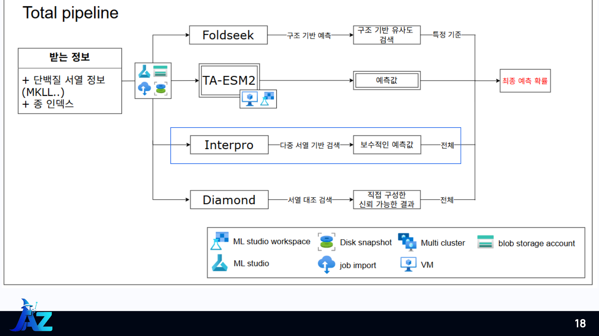

# CAFA-6 | 단백질의 기능을 예측하는 머신러닝 프로젝트

> 단백질의 서열과 3D 구조 정보를 이용해 **이 단백질이 어떤 일을 하는지** 예측하고, CAFA-6 대회 제출용 파일을 만드는 프로젝트입니다.

Microsoft AI School 2차 팀 프로젝트 · **AZ의 마법사**

**담당 — 이주현:** AlphaFold 구조 수집 → Foldseek 검색 → GO 전이·상향 전파 → 앙상블 · [src/cafa_pipeline 전체](src/cafa_pipeline/)

**팀원 코드:** [서열 모델 실험](models/sequence_baselines/)은 **홍지승 작성·보존용**이며, 이주현의 담당 구현과 구분합니다.

[개인 기여와 문제 해결](docs/contributions.md) · [프로젝트 경과](docs/project-history.md) · [보존된 실행 기록](docs/evidence/README.md)

Kaggle에서 개최된 **CAFA 6 Protein Function Prediction** 대회에 참여하며 진행한 프로젝트입니다. 단백질의 기능을 예측하는 실제 대회 과제를 바탕으로 구조 기반 예측과 앙상블을 구현했습니다.

[Kaggle 공식 대회](https://www.kaggle.com/competitions/cafa-6-protein-function-prediction/overview) · [공식 데이터 설명](https://www.kaggle.com/competitions/cafa-6-protein-function-prediction/data) · [대회 리더보드](https://www.kaggle.com/competitions/cafa-6-protein-function-prediction/leaderboard)

## 대회 참가와 성과

**CAFA-6 최종 Private 리더보드 92위 · 은메달(Silver Medal)**

| 항목 | 기록 |
| --- | --- |
| 최종 순위 | 92위 · [공식 리더보드의 Hong jiseung 팀](https://www.kaggle.com/competitions/cafa-6-protein-function-prediction/leaderboard?search=Hong) |
| Private Score | 0.38737 |
| Kaggle 팀 표시명 · 대표 제출자 | [Hong jiseung](https://www.kaggle.com/hongjiseung) |
| 이주현 Kaggle 계정 | [juhyun · @taillessshark](https://www.kaggle.com/taillessshark) |
| 개인 계정의 팀 참가 기록 | [CAFA-6 참가 성과 확인](https://www.kaggle.com/taillessshark/competitions) |

팀 단위로 제출한 결과이며, 이주현의 계정도 해당 팀의 참가자로 등록되어 있습니다. 위 점수는 대회 평가 점수입니다. 확인 기준: 2026-11-06.

## 어떤 문제를 해결하나요?

단백질 서열은 아미노산이 나열된 긴 문자열입니다. 서열만 보고 단백질이 하는 일을 알아내기는 어렵습니다. 이 프로젝트는 **이미 기능이 알려진 단백질과의 유사성**과 **서열 모델의 예측**을 함께 활용합니다.

결과는 GO(Gene Ontology)라는 기능 분류 체계의 번호와 점수로 표현합니다.

| 입력 | 처리 | 출력 |
| --- | --- | --- |
| 단백질 ID·아미노산 서열(FASTA) | 구조 조회·유사 구조 검색·기능 정보 전이·앙상블 | 단백질 ID, GO 기능 번호, 예측 점수(TSV) |

아래는 형식 설명을 위한 가상 결과입니다. 점수는 모델 간 비교·정렬을 위한 값이며, 실제 정답 확률을 보장하지 않습니다.

~~~text
DEMO_Q1    GO:9000001    0.85
DEMO_Q2    GO:9200001    0.72
~~~

## 어떻게 예측하나요?

1. **구조 확보:** AlphaFold DB에서 해당 단백질의 기존 3D 구조를 내려받습니다.
2. **비슷한 구조 찾기:** Foldseek로 모양이 비슷한 단백질을 검색합니다.
3. **기능 정보 가져오기:** 검색된 단백질의 알려진 GO 기능을 유사도에 따라 점수로 변환합니다.
4. **계층 관계 반영:** 세부 기능의 점수가 상위 기능에도 반영되도록 GO 그래프를 따라 전파합니다.
5. **결과 결합:** 다른 모델의 예측과 결합하고, 제출용 파일을 생성·검사합니다.

예를 들어 ‘세부 작업을 할 수 있다’는 예측은 그 작업을 포함하는 ‘상위 작업을 할 수 있다’는 예측과도 일관되어야 합니다. GO 상향 전파는 이런 관계를 반영합니다.

위 그림은 **팀 전체 구성**입니다. 현재 저장소에는 구조 기반 파이프라인·앙상블과 서열 기반 실험 코드가 포함되어 있습니다. TA-ESM2, InterPro, DIAMOND의 모든 원본 구현과 학습 데이터·가중치는 포함되어 있지 않습니다.

## 먼저 작은 예제로 실행해 보세요

**Python 3.10 이상**이 필요합니다. 저장소 루트에서 실행합니다.

~~~bash
python -m pip install -r requirements.txt
python scripts/cafa.py demo
python scripts/cafa.py validate --input artifacts/demo/submission.tsv
~~~

데모는 가상 Foldseek 검색 결과와 작은 GO 그래프를 사용합니다. **GPU·Azure 계정·인터넷 호출 없이**, 기능 전이부터 상향 전파·앙상블·제출 파일 검사까지 실행합니다. 의존성 설치 시에는 인터넷이 필요할 수 있습니다.

| 생성 파일 | 확인할 내용 |
| --- | --- |
| artifacts/demo/raw-go-scores.tsv | 구조 유사도로 생성한 원시 기능 점수 |
| artifacts/demo/normalized/ | 정규화한 BP·MF·CC 점수 |
| artifacts/demo/propagated/ | 상위 기능까지 전파한 점수 |
| artifacts/demo/structure-submission.tsv | 구조 기반 제출 형식 |
| artifacts/demo/submission.tsv | 앙상블한 최종 예제 |
| artifacts/demo/summary.json | 예측 행 수·단백질 수·점수 범위 |

이 예제는 처리 흐름을 확인하기 위한 것으로, 실제 단백질 기능이나 대회 성능을 평가하지 않습니다.

## 코드는 어디부터 보면 되나요?

| 궁금한 내용 | 볼 파일 |
| --- | --- |
| 비슷한 구조에서 기능을 어떻게 가져오는지 | [structure.py](src/cafa_pipeline/structure.py)의 transfer_go |
| GO 계층을 어떻게 반영하는지 | [structure.py](src/cafa_pipeline/structure.py)의 propagate |
| 다른 모델의 예측을 어떻게 결합하는지 | [ensemble.py](src/cafa_pipeline/ensemble.py) |
| 다운로드·구조 검색 방식 | [download.py](src/cafa_pipeline/download.py) · [search.py](src/cafa_pipeline/search.py) |
| 전체 명령과 데모의 실행 순서 | [cli.py](src/cafa_pipeline/cli.py) |
| 홍지승 작성·보존용 ESM 임베딩·CNN·Attention MIL 실험 | [서열 실험 안내](models/sequence_baselines/README.md) |

## 제가 구현한 부분과 해결한 문제

| 문제 | 이주현의 담당 구현 |
| --- | --- |
| 서열·구조·annotation의 ID 연결 | FASTA ID 추출, 기존 구조 수집·검사·재사용과 ID 정리 |
| 대규모 구조 검색 결과 처리 | Azure ML에서 Foldseek 배치 검색과 결과 병합 흐름 구성 |
| 유사 구조를 기능 점수로 바꾸기 | self-hit 제외, annotation 연결, 유사도 가중 GO 전이 |
| 상위 기능과의 일관성·후보 증가 | max 상향 전파, 정규화와 후보 제한, 제출용 결과 생성 |
| 구조 예측의 커버리지 보완 | 팀 예측에 고득점 구조 패치를 적용하고 전역 순위 평균으로 결합 |

당시 노트북의 저장된 출력에는 **30개 검색 배치 파일·2,488,745개 hit 행 병합**이 남아 있습니다. 발표에서는 32코어 CPU 처리 전략을 소개했습니다. 이 값은 보존된 기록이며 이번 정리에서 대규모 검색을 재실행한 결과는 아닙니다.

구조 확보와 GO 기능 전이 성공을 구분한 분석, GO 전파 후 후보 제한과 앙상블의 선택 이유는 [개인 기여 상세](docs/contributions.md)에 정리했습니다. 초기 100개 실험의 입력과 일부 수치는 출처가 달라 [프로젝트 경과](docs/project-history.md)에서 분리해 설명합니다.

### 프로젝트 이후 재현성 개선

2026-11-06에 Codex를 활용해 당시 스크립트·노트북을 현재 Python 패키지와 CLI로 정리했습니다. 공통 TSV 형식, 오류 처리 보완, 가상 데모, 회귀 테스트·CI는 이 후속 정리에 포함됩니다. 당시 대회 작업과 현재의 재현성 개선을 구분합니다.

발표 당시의 수치·선택 이유와 현재 구현의 차이는 [실험 기록](docs/experiments.md)에 정리했습니다.

## 저장소 지도

~~~text
src/cafa_pipeline/          구조 기반 처리·앙상블·공통 TSV 형식
scripts/cafa.py             저장소에서 바로 실행하는 명령 진입점
azureml/                   Azure ML 작업 제출
models/sequence_baselines/ 홍지승 작성 서열 모델 실험·보존용
notebooks/                 데이터 탐색·과거 실험 기록
examples/                  작은 가상 입력과 형식 예제
configs/                   Azure 설정 템플릿
environments/              구조 처리·서열 실험 환경
docs/                      실행 순서·용어·실험·정리 이력
docs/evidence/             과거 출력·ID 목록에서 추린 관찰값
tests/                     처리 로직과 전체 예제 테스트
assets/images/             발표에서 선별한 구성·설명 이미지
data/README.md             실제 데이터 준비 안내
~~~

## 실제 데이터와 클라우드 실행

- [설치와 전체 실행 명령](docs/setup.md)
- [데이터·파일 형식·GO 용어](docs/data-and-glossary.md)
- [구조 기반 방법과 점수의 의미](docs/structure-method.md)
- [Azure ML 제출](azureml/README.md)
- [기존 파일이 어디로 갔는지](docs/reorganization.md)
- [개인 기여와 문제 해결](docs/contributions.md)
- [프로젝트 경과와 실험 수치의 출처](docs/project-history.md)

원본 데이터·GO 매핑·모델 가중치는 별도로 준비해야 합니다. Foldseek 검색은 설치된 실행 파일과 Linux/WSL 또는 Azure Linux 환경을 사용합니다. 전체 대회 학습·제출 결과는 이 예제 실행만으로 재현되지 않습니다.

**당시 사용한 Azure 계정과 리소스는 폐기되어 복구할 수 없습니다.** Azure 제출 코드는 참고용으로 보존하며, 클라우드 실행에는 본인의 새 계정·워크스페이스·컴퓨팅 환경이 필요합니다. 위의 로컬 예제는 기존 Azure 리소스 없이 실행할 수 있습니다.

## 팀과 검증

팀원: 홍지승 · 고아름 · 정성령 · 조수아 · 이주현

이주현은 구조 기반 파이프라인과 앙상블을 담당했습니다. 홍지승이 작성한 서열 모델 실험은 팀 작업의 맥락을 보여주는 참고 코드로 보존했습니다. Kaggle 순위와 은메달은 팀 공동 성과입니다.

~~~bash
python -m unittest discover -s tests -v
~~~

자동 테스트와 가상 예제는 클라우드 작업을 제출하거나 실제 학습을 시작하지 않습니다. GitHub Actions에서도 같은 핵심 흐름을 검사합니다.
