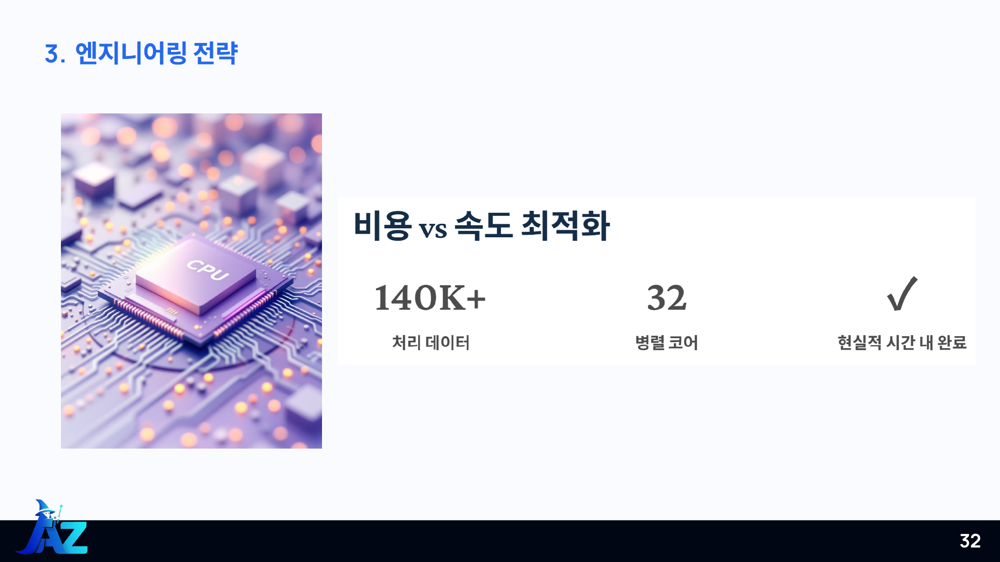

# 실험 기록과 공개 범위

출처는 Microsoft AI School 2차 프로젝트 ‘AZ의 마법사’의 60쪽 발표자료와 정리 전 저장소입니다. 과거 지표를 새로 재현한 결과는 아닙니다.

## Kaggle에서 확인한 최종 성과

2026-11-06에 공식 Kaggle 페이지에서 확인했습니다.

- 최종 Private 리더보드: Hong jiseung 팀 92위, 점수 0.38737, 은메달
- 이주현 참가 계정: juhyun (@taillessshark). 같은 팀원 목록과 개인 프로필의 대회 참가 기록에서 확인
- 개인 프로필의 참가 기록 표시는 92/2259입니다. 이는 프로필에 표시된 순위·참가 규모이며, 특정 시점의 리더보드 필터 행 수와 구분합니다.

[공식 팀 리더보드](https://www.kaggle.com/competitions/cafa-6-protein-function-prediction/leaderboard?search=Hong) · [이주현 대회 참가 기록](https://www.kaggle.com/taillessshark/competitions) · [대표 제출자 프로필](https://www.kaggle.com/hongjiseung)

이 결과는 팀의 실제 대회 성과입니다. 정리된 가상 예제를 실행해 재측정한 점수나 개인 단독 제출 성과로 설명하지 않습니다.

## 팀 전체 접근

발표 18쪽의 팀 파이프라인은 Foldseek, TA-ESM2, InterPro, DIAMOND의 결과를 결합합니다.

현재 공개 범위:
- Foldseek 구조 기반 수집·검색·GO 전이·후처리
- 고득점 패치와 전역 rank 앙상블
- ESM2 650M·3B 임베딩, 1D CNN·Attention MIL 실험
- Azure ML 작업 제출 설정과 일부 과거 노트북

현재 미포함:
- 최종 TA-ESM2의 taxonomy cross-attention 원본 구현
- InterPro·DIAMOND+LMDB 전체 실행 코드·데이터
- FC-MIL 제출 기록이 요구하는 train_fc_mil.py·factorized_context_mil.py
- 원본 대회 데이터·GO 매핑·임베딩·가중치·최종 제출 결과 전체

파일 부재는 현재 공개 범위에 관한 설명이며 실제 수행한 작업의 부재를 뜻하지 않습니다. 개인 기여를 발표용 역할표만으로 제한하지 않습니다.

## 구조 기반 처리

발표 32쪽: 140K+ 처리 데이터, 32개 병렬 코어.
발표 33쪽: GO 자식 → 부모 상향 전파.
발표 34쪽: Top-N과 높은 점수 후보 선별.

발표 수치에는 전체 실행 시간·비용·하드웨어의 완전한 기록이 없어 현재 코드 정리의 실측 성능으로 표현하지 않습니다.

## 서열 모델 실험

발표 41쪽은 내부 학습 지표 약 0.51과 대회 제출 약 0.16의 차이를 소개하며 일반화 문제를 논의합니다. 동일한 평가 정의·분할의 값으로 단순 비교하지 않습니다.

발표 43쪽의 Early/Late Fusion 수치 22.1과 29.3은 지표 단위가 명확하지 않아 대표 성능으로 재사용하지 않습니다. TA-ESM2와 TW-esm2 표기도 혼재하므로 해당 이름을 현재 CNN·MIL 파일과 동일시하지 않습니다.

PCA·attention 시각화는 표현을 탐색하는 분석 기록이며, 생물학적 기능이나 진화 정보를 완전히 학습했다는 보증으로 확대하지 않습니다.

## 현재 검증과 과거 성능

새 가상 예제는 데이터 흐름·파일 형식·상향 전파·앙상블 구현을 검증합니다. 모델 예측 정확도나 대회 점수를 검증하지 않습니다.

최종 성능을 제시하려면 데이터 버전, split, checkpoint, 입력 예측 파일, 앙상블 설정, 평가 도구·지표·결과를 함께 보존해야 합니다.
