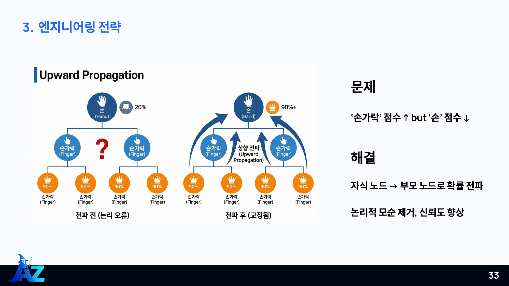

# 구조 기반 예측과 점수의 의미

## 왜 구조를 활용했나요?

서열이 달라도 구조가 유사한 단백질에서 기능 정보를 얻을 가능성을 활용했습니다. 구조 유사성이 기능 일치를 보장하는 것은 아니므로, 구조 검색 결과는 다른 모델과 결합하는 근거로 사용합니다.

AlphaFold 자체를 새로 학습·실행하는 대신 공개 DB의 기존 구조를 수집합니다. Foldseek에서 참조 단백질을 검색하고 알려진 GO annotation을 연결합니다.

## 점수 계산

1. ID를 정리한 후 자기 자신에 대한 검색 결과를 제외합니다.
2. 각 hit의 alntmscore를 최대 1로 제한합니다.
3. 동일 GO를 지지하는 hit 가중치를 더합니다.
4. 단백질별 최대 GO 점수로 나누어 0~1의 상대 점수를 만듭니다.
5. 기본 Top-50·0.2 필터 후 namespace를 분리합니다.
6. 자식 점수를 모든 알려진 조상에 max 방식으로 전파합니다.

원시 합산 점수는 1보다 클 수 있습니다. 정규화한 1.0은 해당 단백질에서 가장 높은 상대 점수라는 뜻이며 정답 확률 100%라는 뜻은 아닙니다.

## 검색과 CPU 처리

발표자료 31~32쪽은 대용량 구조 검색과 32코어 CPU 전략을 소개합니다. 현재 search 명령은 배치 크기·threads·max-seqs를 옵션으로 받습니다. 구조 검색은 Foldseek가 실행하며, GO 전파는 --workers로 프로세스 수를 설정합니다.

코드 정리 과정에서 대규모 구조 DB와 동일한 머신으로 처리량을 재측정하지는 않았습니다.

## GO 일관성

현재 구현은 child score보다 parent score가 낮아지지 않도록 max를 취합니다. 직접 부모 TSV는 조상 관계를 계산하고 순환을 거부합니다. 기존 희소 행렬을 사용할 때는 올바른 조상 closure와 매핑이 준비되어 있어야 합니다.

## 앙상블

첫 단계: 구조 점수 >= 0.99인 쌍을 기본 예측에 덮어쓰거나 새로 추가합니다.

두 번째 단계: 다른 모델에도 같은 패치를 적용한 후, 기존 결합 결과와 전체 행의 백분위 순위를 평균합니다. 같은 점수는 평균 순위를 사용하며 누락 점수는 0으로 채웁니다.

이는 과거 스크립트의 전역 rank 전략을 보존한 것입니다. BP 전용 필터나 단백질별 순위 방식으로 조용히 바꾸지 않았습니다. 비교를 원하면 검증셋에서 별도 실험해야 합니다.

## Top-500과 0.99

제출 생성 단계의 Top-500은 BP/MF/CC 각각 적용됩니다. 앞 단계의 Top-50은 전체 GO 후보에 적용되므로 둘은 다른 처리 단계입니다. 상향 전파가 조상 term을 추가하므로 후단의 후보 제한도 의미가 있습니다.

발표의 ‘99% 신뢰구간’은 저장소에서는 ‘점수 임계값 0.99’로 표현합니다. 통계적 신뢰구간이나 보정된 정답 확률로 해석하지 않습니다.
